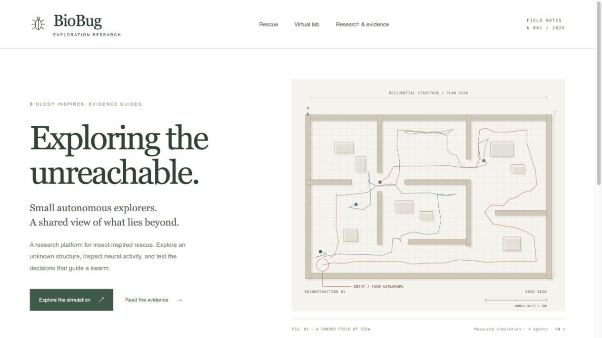

# Academic interface / field atlas

The requested direction was white, restrained and academic, with inspiration from Janelia and Egyptian archaeological sites. The new interface uses white space, serif research headings, small editorial labels, forest-green ink and limestone/ochre map geometry. The home page has one primary action, one architectural figure and three research entry points. Optional controls, explanation and bibliography detail open on demand.

[Harvard's Digital Giza](https://giza.fas.harvard.edu/) was inspected for its archaeological archive hierarchy, architectural imagery and measured editorial presentation. The Janelia reference was interpreted as the research institution associated with the existing [MaleCNS project](https://male-cns.janelia.org/). The Janelia homepage redirected to an access challenge during inspection; no claim is made that its blocked layout was copied. There is no affiliation or endorsement by either institution.

The hero is an original SVG field drawing generated from the residential simulation and recorded information-planner routes (seed 2026, four agents, 60 seconds). Grid, hatch, section labels, north marker and a 200-world-unit scale evoke an archaeological plan without using external photographs or presenting the simulation as an excavated site. This editorial terrain overview is distinct from the operational maps, where unexplored geometry and targets remain hidden.

Generate the route data with `node scripts/render_field_atlas.cjs`. Components: `src/components/FieldAtlas.tsx`, `src/Experiences.tsx`, `src/academic.css`. No external fonts, image API, stock imagery or copied logos are required. Existing map and 3D backgrounds were updated to the same light palette; controller behavior is independent of these render changes.

